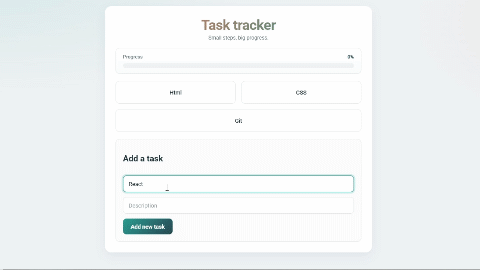

# Task Tracker

A small task tracker built with pure HTML, CSS, and JavaScript. It lets you add tasks, mark them as completed, and see overall progress. Data is saved in `localStorage`, so it persists after page reloads.

## Demo

## Features

- Add a task with a title and description
- Form validation with error highlighting
- Mark a task as completed via a modal window
- Progress bar showing the percentage of completed tasks
- Empty state for the list ("Add the first task")
- Save tasks to `localStorage`
- Close the modal by clicking on the backdrop
- Dynamic `document.title` (task name in the browser tab title)

## Stack

- **HTML5**
- **CSS3**
- **JavaScript (ES6+)**
- **localStorage**